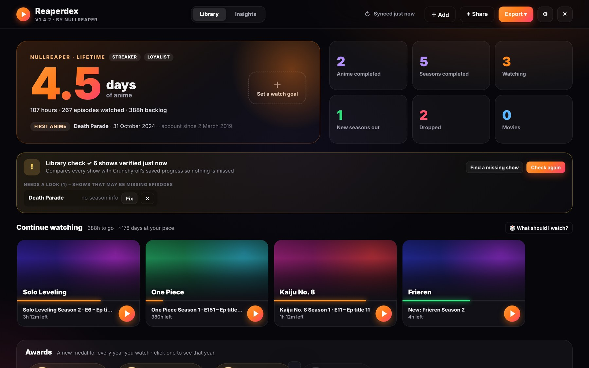
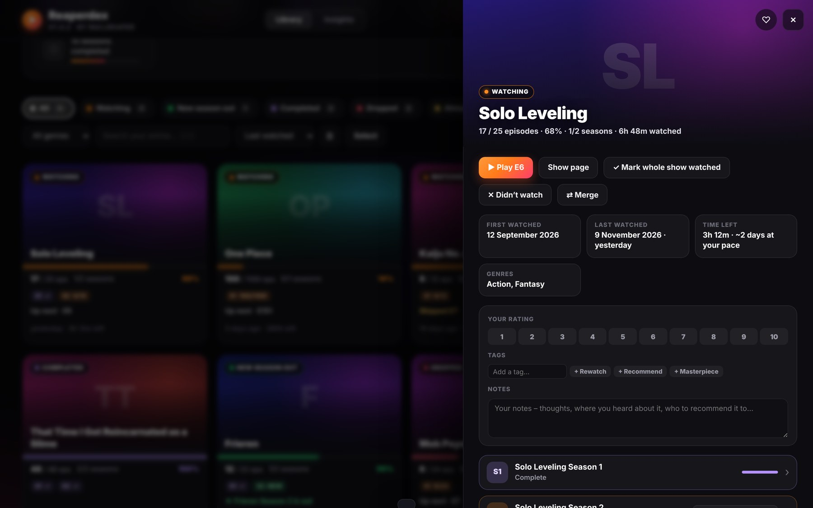
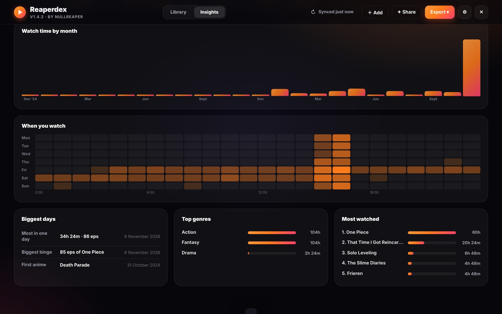
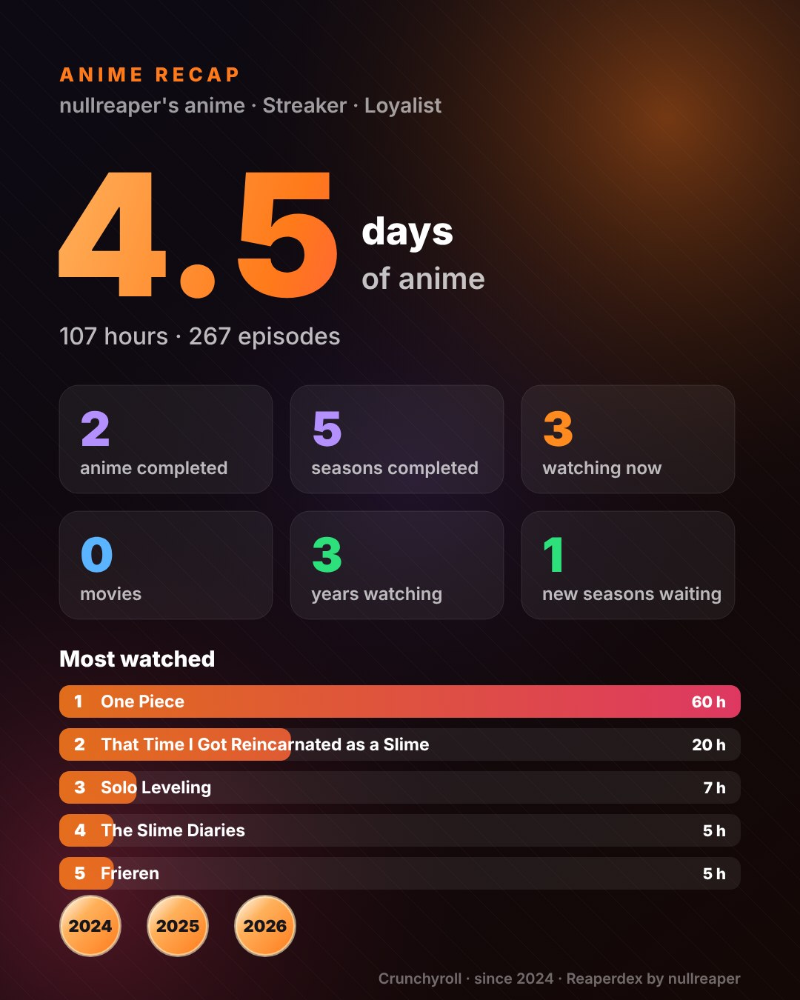

<h1 align="center">Reaperdex</h1>

<b>A free anime tracker for Crunchyroll</b> – your whole history, season by season, right on crunchyroll.com. 
100% in your browser. No account, no server.

  <a href="https://greasyfork.org/en/scripts/604749-reaperdex-anime-tracker-for-crunchyroll"><b>⬇ Install from Greasy Fork</b></a> ·
  <a href="reaperdex-demo.mp4">▶ Watch the 30-second demo</a> ·
  <a href="CHANGELOG.md">Changelog</a>

> **✓ Official sources** – Reaperdex is only published by **nullreaper** on
> [Greasy Fork](https://greasyfork.org/en/scripts/604749-reaperdex-anime-tracker-for-crunchyroll) and here on
> [GitHub (nullreaper-dev/reaperdex)](https://github.com/nullreaper-dev/reaperdex).
> A copy from anywhere else may have been modified – install from Greasy Fork to be safe.

## Features
- **Every show checked episode by episode, season by season** – ✓ watched, partly watched, skipped. Credits-only leftovers count as watched.
- **Smart statuses** – Watching, New season out, Completed, Dropped, Almost done, New episodes – plus a *Paused* reminder, and you can drop a show yourself.
- **Finds what Crunchyroll's history forgot** – an automatic *Library check* compares every show (plus your watchlist and Crunchylists) with Crunchyroll's saved progress; *Find a missing show* pulls any show on demand.
- **Dub & sub merged**, movies split into their own cards.
- **Mark episodes, seasons or whole shows watched** – syncs back to Crunchyroll (with *Mark up to here* and *Undo*).
- **Crunchylists** – add shows to your Crunchylists or turn any filter into a new one, manage your lists, and copy a list into Plan to watch.
- **Fix “1s left”** (Export ▾) – if an older version left episodes showing “1s left” on Crunchyroll, one click saves them as fully watched, keeps your real watch dates and puts Continue Watching back in order. Does nothing if there’s nothing to fix.
- **Auto-sync** from your phone or TV.
- **Other services** – Netflix import, Disney+ / Prime Video manual add. One combined list.
- **Insights** – days of anime, streaks, activity calendar, when you watch, top genres, anime personality, *On this day*.
- **Awards** – yearly medals, milestone badges, watch goals.
- **Ratings, notes, tags, favourites**, "What should I watch?", compare with a friend.
- **Profiles** – your own picture (or your Crunchyroll avatar), banner, 35 titles to earn from Common to Mythic, unlockable frames and a Top 5.
- **Anime ID card**, Plan to watch, "More like this" recommendations and optional airing countdowns.
- **Anime Recap** share cards (all time or any year) and a shareable web page of your list.
- **Exports** – MyAnimeList / AniList XML, Google Sheets, Excel, CSV, backup & restore.
- **8 themes** – Sunset, Cyberpunk, Sakura, Ocean, Aurora, Reaper, Midnight and **Custom** (your own colours, shareable as theme codes).
- **Works on phones** – Firefox for Android + Tampermonkey, with a phone layout.
- **Safety** – daily snapshots of your marks, ratings and profile, full backups, and failed Crunchyroll updates are retried automatically.

| Show panel | Insights | Anime Recap |
|---|---|---|
|  |  |  |

## Install
1. Install a userscript manager: [Tampermonkey](https://www.tampermonkey.net/) or [Violentmonkey](https://violentmonkey.github.io/).
2. Install Reaperdex from **[Greasy Fork](https://greasyfork.org/en/scripts/604749-reaperdex-anime-tracker-for-crunchyroll)** (or open [`reaperdex.user.js`](reaperdex.user.js) → **Raw**).
3. Open **crunchyroll.com** while logged in and click the **Reaperdex** button (bottom right).

## Privacy – what the code talks to
| Where | Why |
|---|---|
| `www.crunchyroll.com` (its own API, with your existing login) | history, seasons, episodes, saved progress, watchlist, your Crunchylists, marking episodes watched |
| `static.crunchyroll.com`, `imgsrv.crunchyroll.com` | show posters and your Crunchyroll avatar (Crunchyroll's own image servers) |
| `graphql.anilist.co` – **only for the MAL/AniList export, or airing countdowns if you turn them on** | looks up MyAnimeList IDs and next-episode times by show title (titles only) |

Nothing else. No analytics, no servers of our own, and **no outside code** – Reaperdex loads no libraries. Data is stored in IndexedDB on crunchyroll.com – use **Export → Backup** to keep a copy.

## Bugs & ideas
Open an [issue](https://github.com/nullreaper-dev/reaperdex/issues) and paste **Export → Copy debug info** (it contains no account ids, tokens or watch dates).

## Licence
**GPL-3.0-or-later** © 2026 [nullreaper](https://greasyfork.org/en/users/1661483-nullreaper), with attribution terms – see [NOTICE.md](NOTICE.md).
Forks are welcome, but must keep the credit "Reaperdex by nullreaper", be marked as modified, and use their own name.

*Reaperdex is an independent project and is not affiliated with Crunchyroll, Netflix, Disney+, Amazon, MyAnimeList or AniList.*
